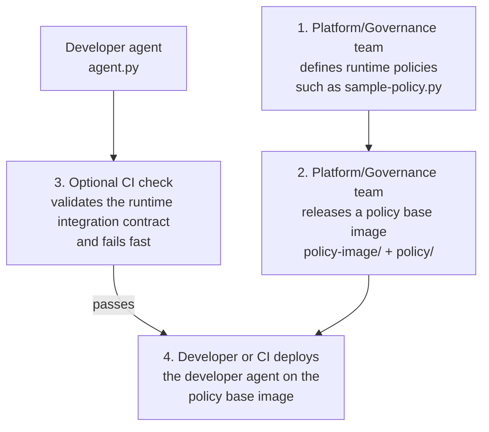
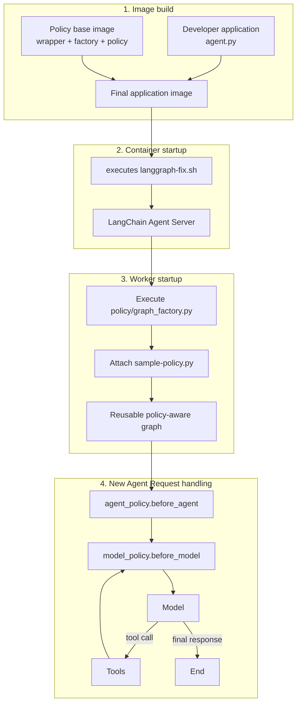
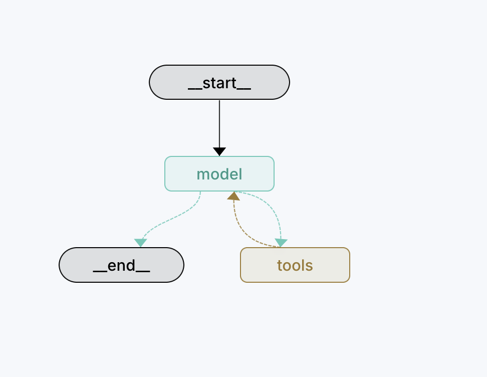
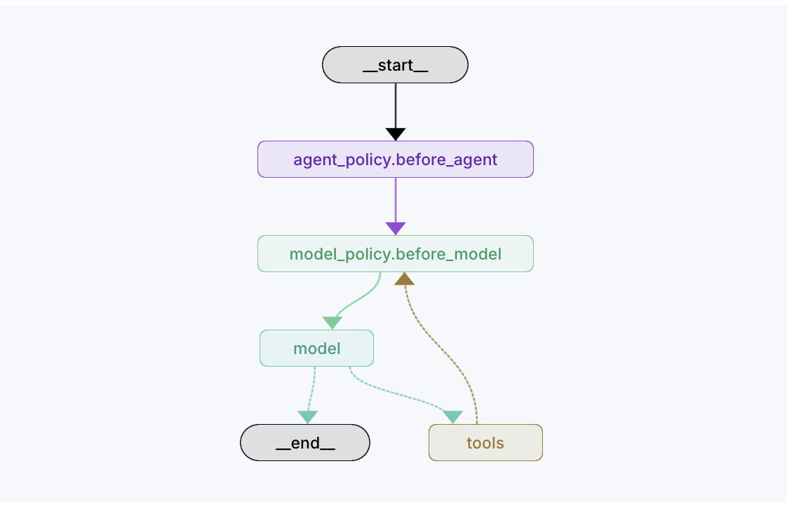

# Runtime policy injection for LangChain Agent Server

## Why this repository exists

More software is being built using agentic patterns such as business wokflows, software eco-system triage (provisioning and error resolution), security and more.
Enterprises and regulated industries need runtime policies and guardrails for
centralized governance, control, and compliance.

This repository demonstrates a runtime composition pattern for attaching
centrally managed [LangChain middleware][middleware-overview] to an
agent. 
Using [LangChain graph factories](https://docs.langchain.com/langsmith/graph-rebuild),
you can rebuild an agent graph and insert control points. The policy-enabled
image uses the policy graph factory, loads the configured middleware, and
compiles a policy-aware graph once per Agent Server worker.

In this project, **runtime injection** has been applied as follows:

1. The served graph target is redirected when the container starts.
2. Policy middleware is loaded and composed into a new graph.
3. The policy middleware hooks execute while requests are processed.


## What this repository demonstrates

The pattern separates application concerns from policy composition:

| Role | Intended responsibility |
| --- | --- |
| Application developer | Owns the model, tools, prompt, and `build_graph` implementation in [`agent.py`](agent.py). |
| Governance team | Owns the middleware in [`policy/sample-policy.py`](policy/sample-policy.py) and the loader in [`policy/graph_factory.py`](policy/graph_factory.py). |
| Platform team | Owns the policy base image, startup wrapper, image build, and deployment process. |

The application developer does not import the policy module directly. Instead,
the developer accepts middleware through `build_graph`, and the deployment
runtime decides which graph target Agent Server serves.

## How runtime policy injection works

The end-to-end workflow starts with governance-owned policy definition and ends
with deployment of the developer's agent on the governed base image:



The policy base image is built from [`policy-image/`](policy-image/) and
incorporates the governance-owned runtime policies and graph-rebuilding code
from [`policy/`](policy/). If enabled, the CI check verifies that the developer
agent follows the integration contract required by that runtime, allowing
incompatible code to fail before image construction or deployment.

The following diagram shows the runtime lifecycle for the sample policy included
in this repository. Your middleware hooks will vary by use case:



The phases work as follows.

### 1. Image build

The platform builds [`policy-image/Dockerfile`](policy-image/Dockerfile), which
adds the policy package and [`langgraph-fix.sh`](policy-image/langgraph-fix.sh)
to a reusable Agent Server base image. `langgraph build` then packages the
developer application on top of that base.

See the official [`base_image` configuration key][configuration-reference] and
[`langgraph build` reference][build-reference].

### 2. Container startup

The final image starts through `langgraph-fix.sh`. The wrapper:

1. Reads the graph mapping from [`langgraph.json`](langgraph.json).
2. Preserves the existing graph registrations.
3. Replaces only graph ID `agent` with
   `./policy/graph_factory.py:graph`.
4. Executes the original Agent Server entrypoint.

The logical graph ID remains stable for callers. The effective mapping changes
from:

```json
{"agent":"./agent.py:graph"}
```

to:

```json
{"agent":"./policy/graph_factory.py:graph"}
```

The wrapper changes the effective runtime mapping; it does **not** edit
`langgraph.json` on disk.

### 3. Worker startup

Agent Server imports the selected graph target. See the official description
of [Agent Server graph loading and compilation][graph-loading]. During that
import:

1. [`policy/graph_factory.py`](policy/graph_factory.py) imports
   `build_graph` from [`agent.py`](agent.py).
2. It executes [`policy/sample-policy.py`](policy/sample-policy.py) by path.
3. It exports the compiled policy-aware graph as `graph`.

The module-level graph is normally imported once and reused by that worker.

### 4. Request handling

The current sample exports two [node-style middleware hooks][middleware-hooks]:

- `agent_policy` uses `before_agent`, which runs once before an agent
  invocation starts.
- `model_policy` uses `before_model`, which runs before every model call. It
  can therefore run more than once when the agent calls a tool and returns to
  the model.

Policy-loading or graph-building errors happen during worker startup rather
than being deferred until the first matching request. This error can be traced in the CD process to take relevant remediation.

### Local and policy-enabled modes

| Aspect | Local development | Policy-enabled image |
| --- | --- | --- |
| Served graph target | `./agent.py:graph` | `./policy/graph_factory.py:graph` |
| Target selected by | `langgraph.json` | `LANGSERVE_GRAPHS` startup override |
| Policy middleware | None by default | `POLICY_MIDDLEWARE` |
| Graph composition | `graph = build_graph()` | `build_graph(middleware=...)` |
| Policy source change | Not loaded in this mode | Requires an updated image and deployment revision |

## Graph topology before and after injection

The first graph is the policy-free graph exported by `agent.py` for local
development:



The policy-enabled graph adds the two sample middleware nodes:



The `before_model` node is revisited after a tool call because the next model
call must also pass through that hook.

## Code module map

Ownership in this table describes the intended organisational split.

| Path | Intended owner | Responsibility and execution point |
| --- | --- | --- |
| [`agent.py`](agent.py) | Application developer | Configures the models, tool, prompt, `build_graph`, and policy-free local `graph`. Imported when a worker loads either graph target. |
| [`langgraph.json`](langgraph.json) | Application developer / platform | Declares Python version, dependencies, environment file, and graph ID `agent`. Used by local development, image builds, and the startup wrapper. See [application structure][application-structure]. |
| [`policy/sample-policy.py`](policy/sample-policy.py) | Governance | Defines the sample `before_agent` and `before_model` hooks and exports `POLICY_MIDDLEWARE`. Executed once when the factory is imported; hook methods execute during requests. |
| [`policy/graph_factory.py`](policy/graph_factory.py) | Governance | Loads and validates the policy export, calls the developer factory, and exports the policy-aware graph. Runs at worker import. |
| [`policy-image/langgraph-fix.sh`](policy-image/langgraph-fix.sh) | Platform | Replaces the effective `agent` graph registration through `LANGSERVE_GRAPHS`, then launches Agent Server. Runs at container startup. |
| [`policy-image/Dockerfile`](policy-image/Dockerfile) | Platform | Builds the reusable policy base image and installs the startup wrapper. Runs at image build time. |

## Developer contract

The following factory signature is the project contract enforced by this
repository's optional validator.

```python
from collections.abc import Sequence
from typing import Any

from langchain.agents import create_agent
from langchain.agents.middleware import AgentMiddleware


def build_graph(
    *,
    middleware: Sequence[AgentMiddleware[Any, Any]] = (),
):
    return create_agent(
        model,
        tools,
        system_prompt=system_prompt,
        middleware=middleware,
    )


# Policy-free graph used by the default local configuration.
graph = build_graph()
```

The optional validator validates that this contract has been followed.

## Policy contract

This example matches the two hook types used by the sample policy:

```python
from langchain.agents.middleware import AgentState, before_agent, before_model
from langgraph.runtime import Runtime


@before_agent(name="agent_policy")
async def agent_policy(
    _state: AgentState,
    _runtime: Runtime,
) -> None:
    print("agent policy ran")


@before_model(name="model_policy")
async def model_policy(
    _state: AgentState,
    _runtime: Runtime,
) -> None:
    print("model policy ran")


POLICY_MIDDLEWARE = (agent_policy, model_policy,)
```


For all available hook types and their timing, see the official
[custom middleware hooks][middleware-hooks].

## Development workflow

The core workflow is:

1. The application developer implements the agent and the developer contract
   in `agent.py`.
2. The developer runs the policy-free graph locally through `langgraph dev`.
3. The governance or platform team defines the policy, graph factory, and
   policy base image.
4. The platform packages the application on the approved base image.
5. The team starts the final image and verifies that the effective graph
   contains the expected middleware nodes.
6. The platform deploys the final image to LangSmith.

## Configuration

### Prerequisites

- Python matching `python_version` in [`langgraph.json`](langgraph.json).
- `uv`, or an equivalent Python environment and package manager.
- Docker with Buildx and Docker Compose for the policy-enabled image workflow.
- `curl` and `jq` for the HTTP verification example.
- Access to the configured model endpoint.
- A LangSmith credential with deployment access for `langgraph up` and when
  deploying to LangSmith Cloud. Self-hosted production use may additionally
  require `LANGGRAPH_CLOUD_LICENSE_KEY`.

### Install project dependencies

The repository includes a lock file for `uv`:

```bash
uv sync
```


### Environment variables

Make sure that relevant variables are present. See `.env.example` file. 

## Run the policy-free graph locally

With the required local runtime configuration available, start Agent Server:

```bash
langgraph dev
```


## Build and verify the policy-enabled image

Run the following commands from the repository root. The image architecture
must match the deployment target.

### 1. Build the policy base image

This will be provided by your Governance team in your organisation. For this repo, you are building it.

```bash
docker build \
  --platform linux/amd64 \
  --file policy-image/Dockerfile \
  --tag langchain-policies-base:3.14 \
  .
```


### 2. Package the application on the policy base

CI system will only use the base container image to build your agent.

```bash
langgraph build \
  --base-image langchain-policies-base \
  --no-pull \
  --platform linux/amd64 \
  --tag langchain-policies-agent:latest
```

This produces the final Agent Server image containing the developer
application and the policy startup mechanism. For related options, see the
official [`langgraph build` documentation][build-reference] and
[`base_image` configuration reference][configuration-reference].

### 3. Start and exercise the final image locally

```bash
langgraph up \
  --image langchain-policies-agent:latest \
  --no-pull \
  --wait
```

In another terminal, submit a run:

```bash
curl -sS http://localhost:8123/runs/wait \
  -H 'Content-Type: application/json' \
  -d '{
    "assistant_id": "agent",
    "input": {
      "messages": [
        {
          "role": "user",
          "content": "Say hello in one sentence."
        }
      ]
    }
  }' | jq
```

A successful response verifies that Agent Server can load and run the graph.


## Deploy to LangSmith Cloud

The `langgraph deploy` command works with LangSmith Cloud and is currently
documented as beta. Authenticate the CLI through its supported environment or
credential mechanism without printing or passing the credential inline.

With this project's pinned CLI, deploy the already-built `linux/amd64` image:

```bash
langgraph deploy \
  --image langchain-policies-agent:latest \
  --name langchain-policies \
  --no-input
```

## License

Licensed under the [MIT License](LICENSE).

## Official documentation

- [LangChain middleware overview][middleware-overview]
- [Custom middleware and node-style hook timing][middleware-hooks]
- [Agent Server graph loading and compilation][graph-loading]
- [LangGraph application structure and `langgraph.json`][application-structure]
- [LangGraph CLI configuration, including `base_image`][configuration-reference]
- [`langgraph build` reference][build-reference]
- [Generate a Dockerfile with the LangGraph CLI][dockerfile-reference]
- [Add Dockerfile instructions with `dockerfile_lines`][custom-docker]
- [LangSmith Deployment overview][deployment-overview]
- [Deploy to LangSmith Cloud][deploy-cloud]
- [`langgraph deploy` reference][deploy-reference]
- [Cloud Agent Server environment variables][deployment-env]
- [Configure environment variables and secrets on a deployment revision][deployment-revisions]

[middleware-overview]: https://docs.langchain.com/oss/python/langchain/middleware/overview
[middleware-hooks]: https://docs.langchain.com/oss/python/langchain/middleware/custom#node-style-hooks
[graph-loading]: https://docs.langchain.com/langsmith/agent-server#graph-loading-and-compilation
[application-structure]: https://docs.langchain.com/langsmith/application-structure
[configuration-reference]: https://docs.langchain.com/langsmith/cli#configuration-file
[build-reference]: https://docs.langchain.com/langsmith/cli#build
[dockerfile-reference]: https://docs.langchain.com/langsmith/cli#dockerfile
[custom-docker]: https://docs.langchain.com/langsmith/custom-docker
[deployment-overview]: https://docs.langchain.com/langsmith/deployment
[deploy-cloud]: https://docs.langchain.com/langsmith/deploy-to-cloud
[deploy-reference]: https://docs.langchain.com/langsmith/cli#deploy
[deployment-env]: https://docs.langchain.com/langsmith/env-var-cloud
[deployment-revisions]: https://docs.langchain.com/langsmith/deployment-revisions#create-a-revision
